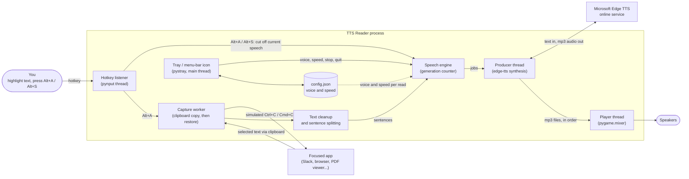

# TTS Reader

A tiny background text-to-speech utility for **Windows and macOS**, in the spirit of Speechify.
Highlight text in *any* app, press a hotkey, and it is read aloud with Microsoft Edge's neural voices.

| Hotkey (Windows) | Hotkey (macOS) | Action |
|---|---|---|
| `Alt + A` | `Option + A` | Read the currently highlighted text |
| `Alt + S` | `Option + S` | Stop speaking and clear the queue |

Features: sentence-by-sentence streaming (the first sentence starts almost immediately), PDF/web line-break
cleanup, URLs are skipped, your clipboard is restored after every capture, a tray / menu-bar icon to pick
the voice and speed, "Start at login" (Windows), and settings that persist between runs.

> Speech is generated by Microsoft's online service through `edge-tts`, so an **internet connection is required**.

## Table of contents

- [Download (Windows)](#download-windows)
- [Run from source](#run-from-source)
  - [Windows](#windows)
  - [macOS](#macos)
  - [macOS permissions (required)](#macos-permissions-required)
- [Usage](#usage)
- [Troubleshooting](#troubleshooting)
- [Architecture](#architecture)
- [How it works (short version)](#how-it-works-short-version)
- [For maintainers: publishing a release](#for-maintainers-publishing-a-release)

## Download (Windows)

1. Open the **[Releases](../../releases)** page of this repository and download the latest
   **`TTSReader-Setup-<version>.exe`** (installer), or **`TTSReader-portable-<version>.zip`** (unzip anywhere and
   run `TTSReader.exe`, no install).
2. Run it. The installer is per-user, so it does **not** need administrator rights.
3. Find the blue speaker icon in the system tray (click the `^` arrow for hidden icons), select some text anywhere,
   and press **Alt + A**.
4. Right-click the tray icon and tick **Start at login** if you want it to launch automatically.

**"Windows protected your PC" warning:** the app is not code-signed (certificates cost money), so Windows
SmartScreen may warn on first run. Click **More info → Run anyway**. Some antivirus programs also distrust any
program that listens for global hotkeys; the full source code is in this repository if you want to inspect or
build it yourself.

Settings and the log file live in `%APPDATA%\TTSReader\` (`config.json`, `reader.log`). The log records errors and
counts, never the text you read.

macOS: there is no packaged download yet. Run from source (below).

## Run from source

Requirements: Python **3.10 – 3.13** (64-bit), working audio output.

### Windows

```powershell
git clone https://github.com/KevinWongCS/tts-project
cd tts-project

python -m venv .venv
.venv\Scripts\activate
pip install -r requirements.txt

python reader.py
```

Run it without a console window with `pythonw reader.py`.

### macOS

```bash
git clone https://github.com/KevinWongCS/tts-project
cd tts-project

python3 -m venv .venv
source .venv/bin/activate
pip install -r requirements.txt

python reader.py
```

The icon appears in the menu bar (top-right of the screen).

#### macOS permissions (required)

macOS blocks apps from watching the keyboard or sending keystrokes until you allow it. The hotkeys will
**silently do nothing** without these steps.

1. Open **System Settings → Privacy & Security → Accessibility**.
2. Click **+** (or flip the switch) and add the app that launches Python — normally **Terminal**, **iTerm**,
   or **VS Code**. If you run a bundled Python directly, add that Python binary instead.
3. Do the same in **Privacy & Security → Input Monitoring**.
4. **Quit and restart** that terminal app, then run `python reader.py` again. (Permissions are only picked up
   when the app starts.)

On first launch the script also triggers the system Accessibility prompt if access is missing.

Notes for macOS:

* `Option + A` / `Option + S` are intercepted so the focused app doesn't type `å` / `ß` over your selection.
* Hotkeys follow the *physical* A and S key positions, so on non-QWERTY layouts the keys may differ.
* Settings are stored in `~/Library/Application Support/TTSReader/`.

## Usage

1. Select (highlight) text anywhere — browser, PDF viewer, Word, an editor, etc.
2. Press **Alt + A** (**Option + A** on macOS). Reading starts after a moment.
3. Press **Alt + A** again on new text at any time to interrupt and read the new selection.
4. Press **Alt + S** to stop.

Tray / menu-bar menu:

* **Voice** – about 30 free Microsoft neural voices, grouped by accent: US, UK, Ireland, Australia, Canada, India,
  South Africa, New Zealand (voices the service doesn't offer are hidden automatically)
* **Speed** – 1.0x, 1.25x, 1.5x, 1.75x, 2.0x
* **Pitch** – Very low, Low, Normal, High (a low pitch on a UK male voice makes a good "wizard narrator")
* **Start at login** (Windows)
* **Stop Speaking**
* **Quit**

A new voice or speed applies to the next selection you read. Choices are saved automatically.

## Troubleshooting

| Problem | Fix |
|---|---|
| macOS: hotkeys do nothing | Grant **Accessibility** and **Input Monitoring** to your terminal, then restart the terminal (see above). |
| Nothing happens on Alt+A (Windows) | Make sure the tray icon is running. Highlight text in a normal app (not a terminal, where Ctrl+C means "interrupt"). Check `%APPDATA%\TTSReader\reader.log`. |
| "Could not generate speech" notification, or no audio | Check your internet connection. If it persists, update the library (`pip install -U edge-tts` from source; or install the newest release) — Microsoft occasionally changes its service. |
| "TTS Reader is already running" | Only one copy can run at a time. Look for the icon in the system tray. |
| Windows: hotkey seems ignored in an elevated (admin) app | Windows doesn't let a normal process send keys to an admin window. Run TTS Reader as administrator too. |
| Windows: `Alt + A` also triggers something in the foreground app | The keystroke is delivered to the app as well; Alt+letter rarely types anything, but a few apps bind it. |
| `pygame.error: No audio device` / mixer failure | Plug in or enable an output device, then restart. |
| Pre-existing clipboard image/file is lost | Only **text** clipboards are saved and restored. |

## Architecture

High-level view of what happens between highlighting text and hearing it:



| Component | Thread | Responsibility |
|---|---|---|
| Hotkey listener | `pynput` daemon thread | Detects Alt+A / Alt+S (Option on macOS) and swallows the keystroke so the focused app never sees it |
| Capture worker | short-lived thread | Saves your clipboard, simulates copy, reads the selection, restores the clipboard |
| Text cleanup | capture thread | Joins broken lines, removes URLs, splits into sentences (short first chunk for a fast start) |
| Speech engine | shared state | Holds a *generation counter*; any new read or Stop bumps it so older work is discarded |
| Producer | asyncio thread | Synthesizes several sentences in parallel with `edge-tts` into temporary `.mp3` files |
| Player | only thread touching audio | Plays finished sentences in order with `pygame.mixer` and deletes each file afterwards |
| Tray / menu-bar icon | main thread | Voice and speed menus, Stop, Quit, "Start at login" (Windows); settings saved to `config.json` |

## How it works (short version)

1. `pynput` listens for the hotkeys in a background daemon thread and swallows the Alt+A / Alt+S keystrokes so
   the focused app (for example Slack) never reacts to them; `pystray` owns the main thread (required on macOS).
2. On read, the app saves your clipboard, simulates `Ctrl + C` / `Cmd + C`, waits ~100 ms, reads the text,
   and restores your clipboard.
3. Text is cleaned (broken lines joined, URLs removed) and split into sentences.
4. Several sentences are synthesized in parallel to temporary `.mp3` files with `edge-tts`; a player thread plays
   them in order with `pygame.mixer` and deletes each file afterwards.
5. Interrupting just invalidates the old speech (a generation counter), so rapid `Alt + A` / `Alt + S`
   presses never crash or overlap.

## For maintainers: publishing a release

Windows builds are produced automatically by GitHub Actions (`.github/workflows/build-windows.yml`):

```bash
git tag v1.0.0
git push origin v1.0.0
```

A few minutes later the **Releases** page has the installer and portable zip. The version number is taken from the
tag. To test a build without releasing, open the repo's **Actions** tab, choose **Build Windows release →
Run workflow**, and download the result from that run's *Artifacts*.

Build locally (Windows, in an activated venv):

```powershell
pip install pyinstaller
python -c "import reader; reader.make_icon_image(256).save('app.ico')"
pyinstaller --noconfirm --clean --onedir --windowed --name TTSReader --icon app.ico --collect-submodules pynput --hidden-import pystray._win32 reader.py
```

The result is in `dist\TTSReader\`. The installer script is `installer.iss` (needs Inno Setup).
